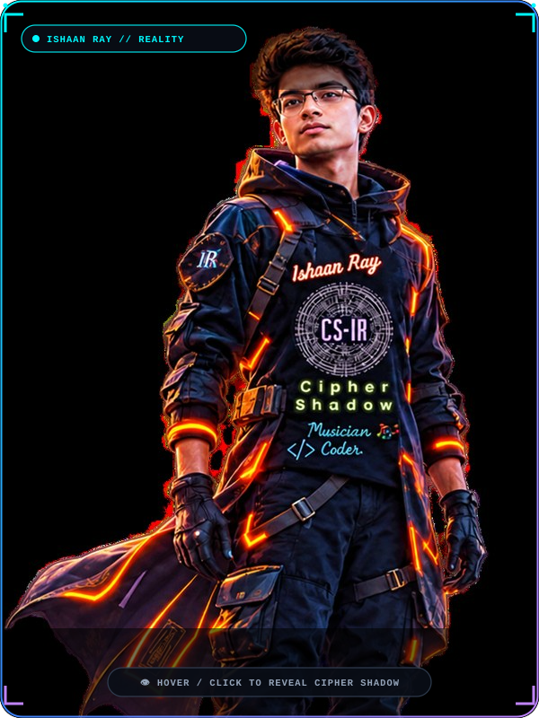
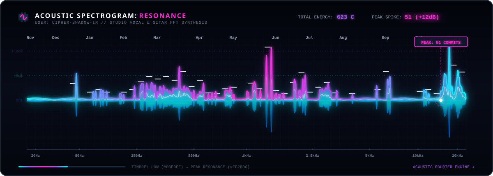

<!-- ═══════════════════════════════════════════════════════════ -->
<!--                  ISHAAN RAY — CIPHER SHADOW                -->
<!-- ═══════════════════════════════════════════════════════════ -->

<!-- MAIN TYPING BANNER -->

  

<!-- PROFILE VIEWS + QUOTE STRIP -->

  
  

---

<!-- ════════════════ CINEMATIC PORTFOLIO ════════════════ -->

 

<!-- LIVE PORTFOLIO SCREENSHOT -->

 

<code><i>what you build defines you — Ishaan Ray</i></code>

---

<!-- 🧬 Cosmic Identity -->
<h1 align="center">✨ Who is Ishaan Ray?</h1>

| 🚀 Cosmic Identity | ✨ System Log & Arsenal |
| :---: | :---: |
|  | 🚀 **Full Stack Engineer:** Architecting zero-to-one MVPs, backend infrastructure, and AI workflow orchestration.  ⚡ **Core Stack:** Next.js, Node.js, Python, PostgreSQL, Redis, and WebSockets.  🎶 **Musician:** 10+ Instruments, Certified Drummer, Sangeet Visharad.  🌌 **Portfolio:** [galaxir.vercel.app](https://galaxir.vercel.app/)  📡 **Comm-Link:** `ishaanray.cs.19@gmail.com`  🌟 **Motto:** *Push your limits beyond universe.* |

 

<!-- ⚔️ Galactic Tech Stack -->
<h1 align="center"><i>🧰 Galactic Tech Arsenal</i></h1>

  

<h2 align="center">🖥️ Programming Languages</h2>

&nbsp;
&nbsp;
&nbsp;
&nbsp;
&nbsp;
&nbsp;
&nbsp;
&nbsp;
&nbsp;
&nbsp;
&nbsp;
&nbsp;
&nbsp;
&nbsp;

<h2 align="center">🎨 Frontend Development</h2>

&nbsp;
&nbsp;
&nbsp;
&nbsp;
&nbsp;
&nbsp;
&nbsp;
&nbsp;
&nbsp;
&nbsp;
&nbsp;
&nbsp;
&nbsp;
&nbsp;
&nbsp;
&nbsp;

<h2 align="center">⚙️ Backend Development</h2>

&nbsp;
&nbsp;
&nbsp;
&nbsp;
&nbsp;
&nbsp;
&nbsp;
&nbsp;
&nbsp;
&nbsp;

<h2 align="center">🗄️ Databases</h2>

&nbsp;
&nbsp;
&nbsp;
&nbsp;

<h2 align="center">🤖 Artificial Intelligence / Machine Learning</h2>

&nbsp;
&nbsp;
&nbsp;
&nbsp;

<h2 align="center">🛡️ Cybersecurity & Ethical Hacking</h2>

  
  
  
  
  
   
  <b>Other Tools:</b> Metasploit · Burp Suite · Nmap · Wireshark · Nessus · OSINT Frameworks

<h2 align="center">☁️ Cloud & DevOps</h2>

&nbsp;
&nbsp;
&nbsp;
&nbsp;
&nbsp;
&nbsp;
&nbsp;

<h2 align="center">🚀 BaaS & Hosting</h2>

  
  
  
  
  

<h2 align="center">🧪 Testing & Tools</h2>

&nbsp;
&nbsp;
&nbsp;
&nbsp;
&nbsp;
&nbsp;
&nbsp;
&nbsp;
&nbsp;
&nbsp;
&nbsp;

<h2 align="center">🪐 OS / Environments</h2>

  
  
  
  
  

---

<!-- 🌌 Galactic Projects -->
<h1 align="center"><i>🚀 Featured Mission Logs</i></h1>

<table width="100%">
<tr>
<td width="50%" align="center" valign="top">

### Leadspiray
<b>Concurrency-Safe Lead Engine</b>

  &nbsp;&nbsp;&nbsp;

</td>
<td width="50%" align="center" valign="top">

### HRMS-GU
<b>University Microservices Core</b>

  &nbsp;&nbsp;&nbsp;

</td>
</tr>
<tr>
<td width="50%" align="center" valign="top">

### ProCMMS360
<b>Industrial Lifecycle Engine</b>

  &nbsp;&nbsp;&nbsp;

</td>
<td width="50%" align="center" valign="top">

### Aspiron
<b>Predictive Admission Engine</b>

  &nbsp;&nbsp;&nbsp;

</td>
</tr>
<tr>
<td width="50%" align="center" valign="top">

### AEGENTRIX
<b>Zero-Trust PEP for Multi-Agent AI</b> <b>🏆 1st Place Winner • MLH Hacktoberfest Hack Day Ahmedabad 2026</b>

  &nbsp;&nbsp;&nbsp;

</td>
<td width="50%" align="center" valign="top">

### Automated RFP
<b>AI Procurement & Semantic Matcher</b> <b>⚡ Built for EY Techathon 6.0</b>

  &nbsp;&nbsp;&nbsp;

</td>
</tr>
<tr>
<td width="50%" align="center" valign="top">

### CLARIRY
<b>100% Offline AI Audio Mentor</b>

  &nbsp;&nbsp;&nbsp;

</td>
<td width="50%" align="center" valign="top">

### BrandSphere AI
<b>Enterprise Brand Governance & CI/CD</b> <b>🎖️ Round 2 Finalist • Inkloom AI Hackathon (CODESTAR 30)</b>

  &nbsp;&nbsp;&nbsp;

</td>
</tr>

<tr>
<td width="50%" align="center" valign="top">

### CODIVIR
<b>Real-Time Collaborative Cloud IDE</b>

  &nbsp;&nbsp;&nbsp;

</td>
<td width="50%" align="center" valign="top">

### Vectirix
<b>Visual DAG AI Pipeline Orchestrator</b>

  &nbsp;&nbsp;&nbsp;

</td>
</tr>
<tr>
<td width="50%" align="center" valign="top">

### Redis Engine Laboratory
<b>Distributed Locking & Telemetry Lab</b>

  &nbsp;&nbsp;&nbsp;

</td>
<td width="50%" align="center" valign="top">

### Kafka Mastery Laboratory
<b>Event-Driven High-Throughput Streams</b>

  &nbsp;&nbsp;&nbsp;

</td>
</tr>
</table>

 

---

<!-- 🎵 Music Meets Machine -->

  <h2>🎼 Music Alchemy</h2>
  

    🎹 10+ Instruments &nbsp;|&nbsp; 🥁 Certified Drummer &nbsp;|&nbsp; 🎻 Sangeet Visharad  
    🎻 Violinist &nbsp;|&nbsp; 🎸 Guitarist &nbsp;|&nbsp; 🪘 Sitarist &nbsp;|&nbsp; and many more...
  

---

<!-- 📊 Git Stats -->
<h1 align="center">Git Stats</h1>

  

  <picture>
    <source media="(prefers-color-scheme: dark)" srcset="./assets/acoustic-spectrogram.svg">
    <source media="(prefers-color-scheme: light)" srcset="./assets/neon-cityscape-horizon.svg">
    
  </picture>

---

<!-- 🔗 Contact Transmission -->
<h2 align="center">📡 Connect Across the Multiverse</h2>

  

  
  
  

---

<!-- 🌠 Cosmic Footer -->

  

